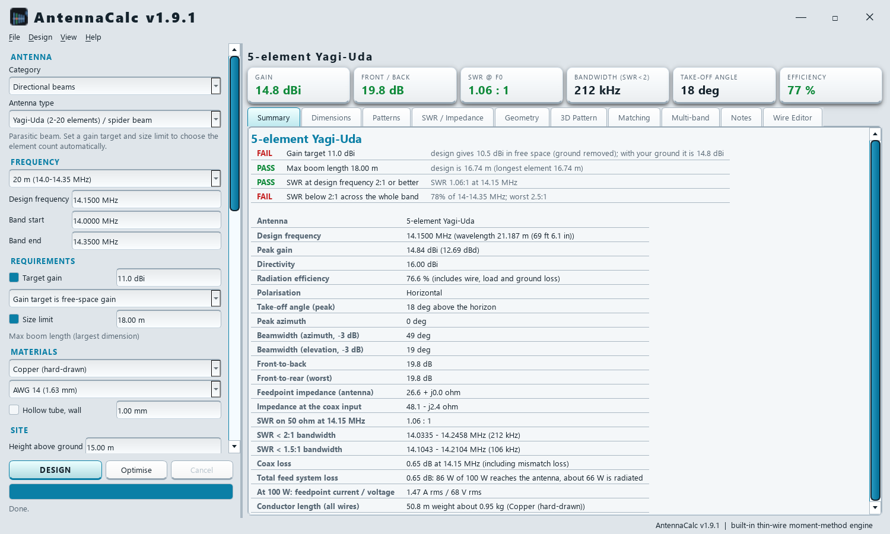

# AntennaCalc

**Design amateur-radio antennas to your requirements** - band, gain target, size limit, conductor material and size, height and ground - and get the dimensions, expected performance and matching.

Site: https://lrizio.github.io/AntennaCalc/ &nbsp;|&nbsp; Download: see [Releases](https://github.com/lrizio/AntennaCalc/releases) (Windows, no install)



* **51 antenna designs** in seven categories: HF wire, verticals, directional beams, compact/loaded, VHF/UHF/satellite, microwave, receive-only (dipoles, OCFD, G5RV, fan/trap dipoles, EFHW, loops, rhombic, GP, J-pole, Yagi, quad, LPDA, Moxon, phased arrays, half-square / Bobtail curtain, Bruce array, Sterba curtain, W8JK, delta loop, helix, dish, horn, patch, slot arrays, magnetic loop, K9AY and many more).
* **Real simulation** for wire antennas with a built-in thin-wire method-of-moments solver (`antennacalc/mom.py`): impedance, SWR sweep, gain, patterns, efficiency, ground effects, traps, coils, loads, phased feeds, LPDA harness.
* **Wire Editor**: draw your own wire antenna in front / top / side views, label and dimension the wires interactively, and put sources and loads (R + jX, series or parallel R-L-C traps) anywhere on them - then simulate it like any built-in design.
* **The whole station as it is wired**: feed line (ladder line, twin-lead, open wire or coax), balun or unun with its own ratio and loss, coax, and a tuner at the radio. Every line's loss is calculated at its real SWR, the tuner's loss is estimated from the L or T network it needs, and the Matching tab lists each part with its impedance, SWR and the watts it loses.
* **Coax common-mode current**: the outside of the coax shield is modelled from the balun to the radio along a route you set, with the balun's choke impedance and an optional extra choke down the coax; the current on it and the heat in each choke are reported. The Geometry tab draws the feed system too.
* **Gain target + size limit**: beams pick their own element count. **Auto-tune** and an **optimiser** for gain / front-to-back.
* Results: PASS/FAIL checks, cut list (m and ft/in) with weight, azimuth/elevation patterns, rotatable 3-D pattern with the antenna drawn inside it, SWR and impedance, matching network values, multi-band table, PDF report, NEC-2 export.

## Run from source

```
pip install PySide6 numpy scipy
python main.py
```
Tests: `pip install pytest` then `python -m pytest tests -q`. Build the exe: `python build_exe.py`.

## Accuracy and safety

Results are engineering estimates; always trim on an antenna analyser. See [DISCLAIMER.md](DISCLAIMER.md). Licence: [MIT](LICENSE).

73 de VK3EI
